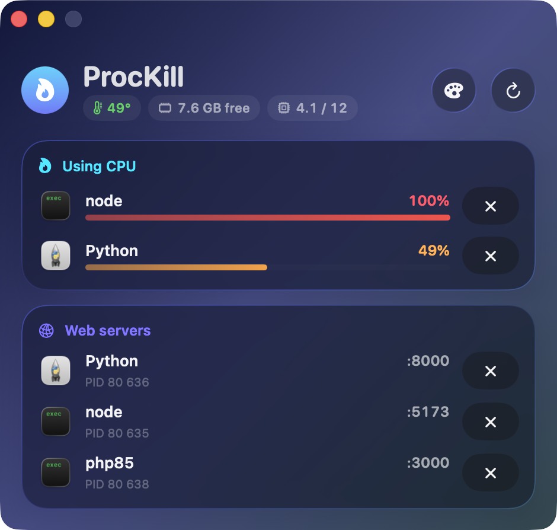
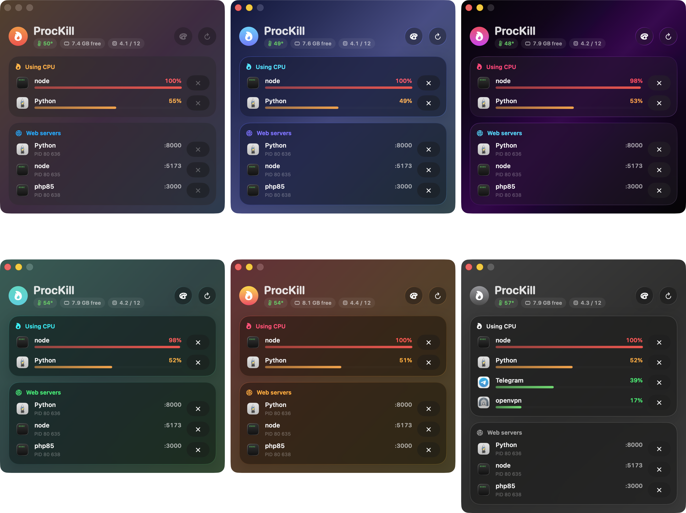
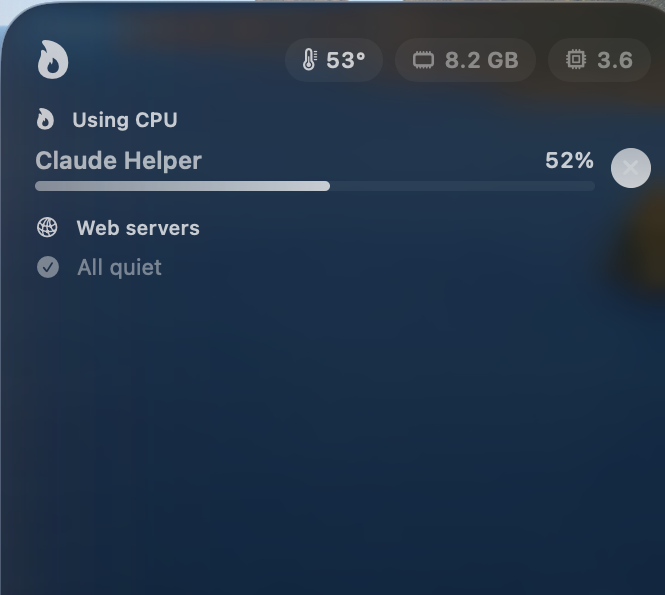

# ProcKill

A tiny macOS app that shows what is heating up your Mac and lets you kill it in two clicks — from a window, the menu bar, or a desktop widget. Built with SwiftUI and Liquid Glass for macOS 26.



## What it shows

- **Processes using the CPU** — your own processes above 15% CPU, with real app icons and a load bar that goes green → orange → red.
- **Web servers** — everything listening on a TCP port (`php artisan serve`, `vite`, `python -m http.server`, Docker…), one row per process with all its ports.
- **Orphaned shells** — `zsh`/`bash` left behind by terminals and AI agents, with a one-click "kill all idle".
- **CPU temperature, free RAM and load average**, plus a red *Throttling* badge when macOS starts slowing the CPU down.

System processes are hidden, so you can't kill something macOS needs by accident. Every kill takes two clicks: ✕, then *Sure?*.

## Skins

Six themes — Liquid, Midnight, Neon, Mint, Sunset, Graphite. Pick one with the palette button; the widget follows.



## Desktop widget

Medium and large sizes. The ✕ buttons work right on the desktop.



The widget runs in a sandbox and can't see other processes, so the app does the work: it publishes a snapshot to a shared App Group every 20 seconds and executes kill requests the widget drops there. Before killing, the app checks that the PID still belongs to the same process name, so a reused PID is never killed by mistake. **Keep ProcKill running** (add it to Login Items) for the widget to update.

## Languages

English, Русский, Қазақша — follows the system language, or set it per app in *System Settings → General → Language & Region → Applications*.

## Build

Requirements: macOS 26, Xcode 26, [XcodeGen](https://github.com/yonaskolb/XcodeGen) (`brew install xcodegen`) and an **Apple Development** certificate (sign in to Xcode → Settings → Accounts; a free account works).

```sh
./build.sh
cp -R ProcKill.app ~/Applications/
open ~/Applications/ProcKill.app
```

`build.sh` picks your first Apple Development certificate and derives the App Group from its Team ID. To use a specific one: `IDENTITY_HASH=<sha1> TEAM=<team id> ./build.sh`.

Then right-click the desktop → *Edit Widgets* → search *ProcKill*.

`ProcKill.app/Contents/MacOS/ProcKill --dump` prints the current lists to the terminal; `--selftest` runs the parser checks.

## How temperature is read

Apple Silicon has no public temperature API. ProcKill reads the CPU die sensors (`PMU tdie*`) through the private IOHID event system — the same approach Stats and iStat Menus use. No root needed, but a future macOS update may change it; the chip then shows "—".

## Files

| File | What |
|---|---|
| `App.swift` | data collection (`ps`, `lsof`, sensors), the window/menu bar UI, the widget feed |
| `Widget.swift` | the WidgetKit extension and the kill intent |
| `Shared.swift` | model, skins and views shared by app and widget |
| `Localizable.xcstrings` | translations |
| `project.yml`, `build.sh` | project generation, build and signing |

## License

MIT
